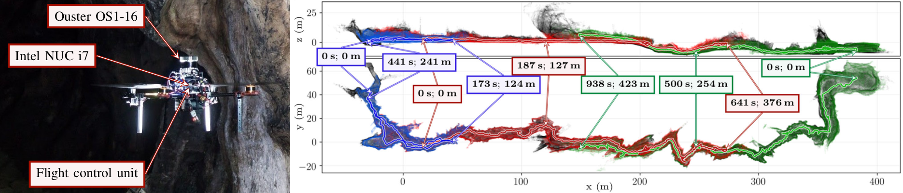
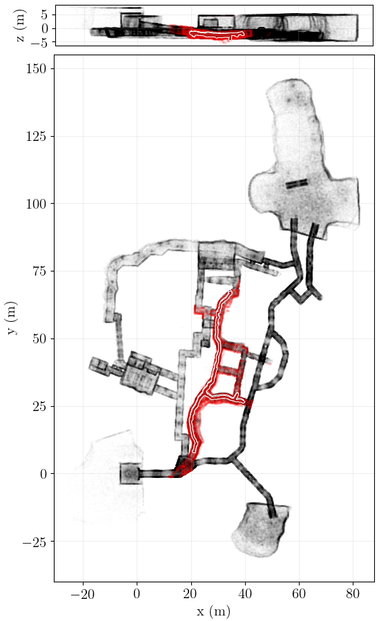
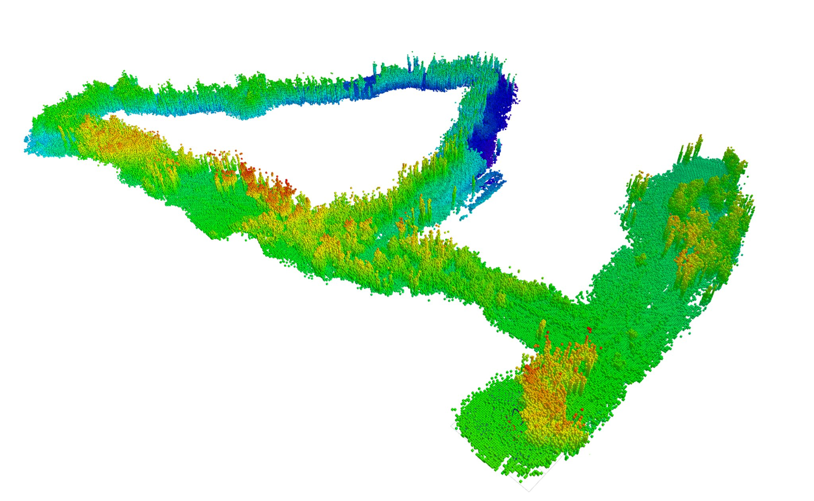
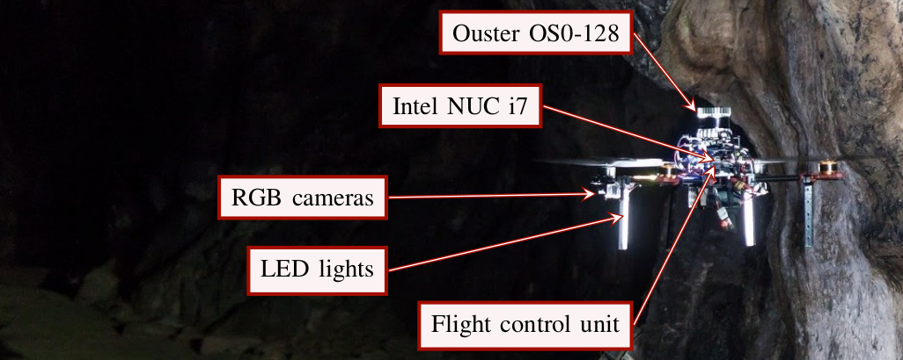
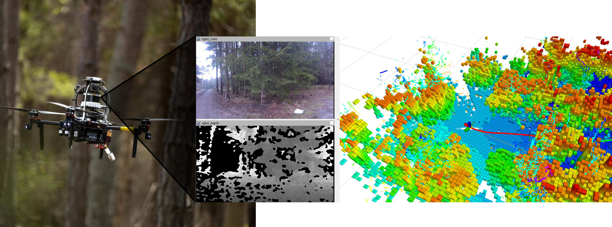

<h1 align="center">SLAM Datasets</h1>

<p align="center">
Public datasets<sup>[1]</sup> recorded onboard autonomous UAVs for research on laser-based SLAM, localization, and mapping in GNSS-denied and perceptually degraded environments — subterranean caves, mines, and dense forest.
</p>

<p align="center">
  
  
  
</p>

## Datasets

| | | |
|:---:|:---:|:---:|
| **[Bull Rock Cave](./bull_rock_cave/README.md)** <sup>[1]</sup> | **[DARPA Subterranean Challenge](./subt_finals/README.md)** <sup>[1, 2]</sup> | **[Forest](./forest/README.md)** |
| Long, narrow subterranean flights with no loops | Nine flights through mines, caves, and a metro, incl. dust noise and a loop | 1.25 km / 19-minute flight through a sparse forest |
| Ouster OS1-16 LiDAR + IMU | Ouster OS0-128 LiDAR + stereo Basler cameras | Ouster OS0-128 LiDAR, Realsense D435, RTK GPS |

### Bull Rock Cave

Two datasets (red and green trajectories below) recorded onboard a UAV flying within the Bull Rock Cave system in central Bohemian Karst <sup>[1]</sup>.
Long flights in a narrow subterranean environment, no loops, average speed ~0.5 m/s, with a dynamic obstacle (a safety operator walking behind the UAV).

<p align="center">
  
</p>

The rosbags contain unsynchronized LiDAR points and IMU measurements. Ground truth trajectories were estimated by registering onboard data against a precise Leica BLK360 3D scan of the cave.

➡️ See the [full README](./bull_rock_cave/README.md) for sensor topics, frames, and folder structure.

### DARPA Subterranean Challenge: Finals

Nine datasets recorded onboard an autonomous UAV system deployed within the DARPA Subterranean Challenge Finals environment (post-event testing) <sup>[1, 2]</sup>.
Mid-range flights through extremely narrow subterranean environments — mines, caves, and a metro — with perceptual degradation from whirling dust, and one mine-cave-mine loop.

<p align="center">
  
</p>
<p align="center">
  
</p>

The rosbags contain unsynchronized LiDAR points and image streams from two Basler cameras. Ground truth trajectories were estimated by registering onboard data against a map of the environment.

➡️ See the [full README](./subt_finals/README.md) for the per-dataset table (length, environment, dust, GoPro footage), sensor topics, and frames.

### Forest

A ~1.25 km-long, 19-minute flight through a sparse forest, created to test large-scale localization and mapping techniques that often struggle outside of small, clean, feature-full laboratory environments.

<p align="center">
  
</p>
<p align="center">
  
</p>

The rosbags contain unsynchronized LiDAR points, IMU measurements, and RGBD data, with intermittent RTK GPS (Integer FIX) recording. Ground truth is provided via onboard GPS (Pixhawk) and RTK GPS (Emlid Reach).

➡️ See the [full README](./forest/README.md) for sensor topics, frames, ground truth odometry topics, and an example rviz session.

## Folder structure

```
slam_datasets
│   download.sh
├───bull_rock_cave
├───subt_finals
└───forest
```
- To download the datasets, run script `download.sh [datasets]`.
  - **Beware**, the datasets can be large!
  - Datasets can be downloaded by specifying a comma-separated list of datasets:
    - `./download.sh "bull_rock_cave,subt_finals"`
  - All datasets will be downloaded if no argument is given.

## References
- [1] Petracek, P.; Kratky, V.; Petrlik, M.; Baca, T.; Kratochvil, R.; Saska, M. *Large-Scale Exploration of Cave Environments by Unmanned Aerial Vehicles,* IEEE Robotics and Automation Letters 2021, 6, 7596–7603.
- [2] V. Kratky, P. Petracek, T. Baca and M. Saska, *An autonomous unmanned aerial vehicle system for fast exploration of large complex indoor environments,* Journal of field robotics, May 2021.

[^1]: Datasets are stored on internal MRS [NAS](https://nasmrs.felk.cvut.cz/index.php/apps/files/?dir=/shared/PERMANENT/slam_datasets&fileid=2620203).
